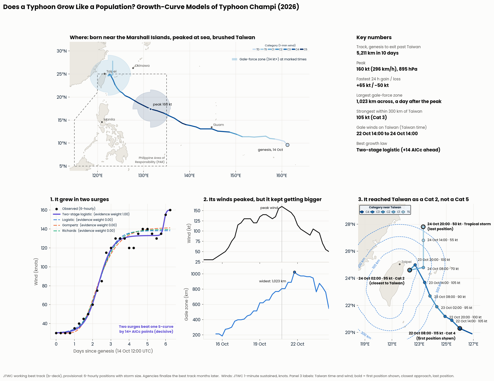
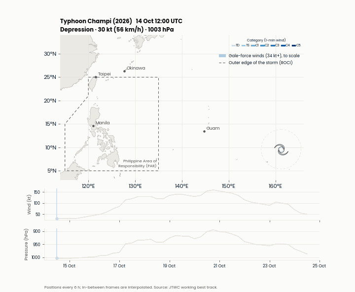

# Does a Typhoon Grow Like a Population?
### Growth-Curve Models of Typhoon Champi 🇹🇼 (2026)

*Typhoons in an El Niño Year, Part 1 of 3*

   



## TL;DR

Typhoon Champi did not grow along one S-curve. It grew in two stages, like bacteria that finish one food, pause, then switch to a second and grow again: a surge to about 133 knots, nearly three days of wobbling at that level, then a second surge to 160 knots. A two-stage growth curve beats every single S-curve decisively, while the three classic single curves (logistic, Gompertz, Richards) cannot be told apart. That margin rests on the final 12-hour jump from 135 to 160 knots, which matches how eyewall replacement cycles end, but it is two satellite-based readings, and a stress test in the notebook shows it. Champi also kept getting bigger after it peaked. It reached Taiwan as a Category 2, not the Category 5 it had been at sea, but large and slow, and by the agency's wind radii its gale-force winds reached Taiwan's coast for about two days: the strongest moment is not the moment it hits.

> All numbers are **provisional**: they come from the Joint Typhoon Warning Center's working best track. They will be rerun on the final best track once the agencies release it.



## About

**North Star question:** How did Champi grow from a tropical depression into a super typhoon, and which simple growth law describes that growth best?

**Short answer:** Two surges with a pause between them. The single S-curves all level off too early and miss the late surge to the peak; the two-stage logistic follows both.

### Key results (provisional)

| Measure | Value |
|---|---|
| Track covered | 14 Oct 12:00 to 24 Oct 12:00 UTC (official genesis to exit north of Taiwan) |
| Track length | about 5,200 km |
| Peak | 160 kt (296 km/h), 895 hPa, 20 Oct 18:00 UTC |
| Days at super typhoon strength (130+ kt) | about 3.8 |
| Fastest 24-hour gain / loss | +65 kt / -50 kt (rapid intensification threshold: 30 kt) |
| Growth contest (AICc gap from best) | Two-stage logistic best; logistic +14.2, Gompertz +14.5, Richards +17.1 |
| Two-stage fit | first plateau about 133 kt, second surge on 20 Oct, ceiling 160 kt |
| Stress test (two-stage lead) | stays decisive without any early position; +7.3 without the 155 kt reading; +2.6 without the 160 kt peak; single curve wins if the window ends 12 h early |
| Decay / rise rate | 1.0 to 1.7 depending on the end point (Emanuel 2000 average: 0.67) |
| Gale-force zone, average diameter | about 210 km at first report, 810 km at peak wind, 1,020 km at its largest (a day after the peak) |
| Tightest eyewall (radius of maximum winds) | about 9 km, 17 Oct, at the end of the fastest strengthening |
| Closest approach to Taiwan's coast | about 50 km, 24 Oct 02:00 Taiwan time, as a Cat 2 (95 kt, 951 hPa), three categories below its peak far out at sea |
| Strongest wind within 300 km of Taiwan's coast | 105 kt (Cat 3), 23 Oct 14:00 Taiwan time, 181 km out |
| Gale-force winds reach Taiwan's coast | 22 Oct 14:00 to 24 Oct 14:00 Taiwan time (by JTWC's radii) |

## The series

| Part | Release | Question |
|---|---|---|
| **1. Does a Typhoon Grow Like a Population?** | October 2026 | What shape did Champi's strengthening take? |
| 2. The Split | November 2026 | Do El Niño and La Niña typhoons differ, and where does Champi fall? |
| 3. Champi's Twins | December 2026 | Which past storms is Champi most like? |

## Repository Structure

```
champi-2026-typhoon-runway/
├── champi_growth_curves.ipynb      the notebook (Part 1)
├── champi_utils.py                 loading, measuring, fitting and plotting helpers
├── data/
│   ├── champi_2026_track.csv       Champi's 6-hourly track with storm size, processed and ready to use
│   ├── land_wpac.geojson           coastlines for the maps and Taiwan distances
│   └── README_DATA.md                   data dictionary and sources
├── figures/                        maps, charts, the animation and the graphical abstract (refreshed on run)
├── results/                        tables and summary.json (refreshed on run)
├── requirements.txt
└── LICENSE
```

## How to Reproduce

Works in any Jupyter environment.

```bash
git clone https://github.com/jprmaulion/champi-2026-typhoon-runway.git
cd champi-2026-typhoon-runway
pip install -r requirements.txt
```

Then open `champi_growth_curves.ipynb` and run all cells. It takes about two minutes (most of it drawing the animation) and needs no internet: the processed data files ship in `data/`.

## Data

- **Track:** Joint Typhoon Warning Center working best track (ATCF b-deck) for 29W Champi, via the UCAR RAL repository. Position, 1-minute sustained wind (knots), pressure, and storm size: outer closed isobar (ROCI), radius of maximum winds (RMW) and gale-force radius by quadrant (R34). Cross-checked against IBTrACS v04r01 (ACTIVE file). The repository ships the processed file; how it was built from the raw records is covered in a companion project (December 2026).
- **Coastlines:** Natural Earth 1:50m land, public domain.
- **Boundary:** Philippine Area of Responsibility corners from PAGASA.

Data dictionary and source links in [`data/README.md`](data/README.md) and in the notebook's Data section.

## Methods

1. Trace the track and animate it, with the gale-force zone and outer edge drawn to scale.
2. Measure the journey: track length, days at each strength level, largest 24-hour gain and loss, closest approach to Taiwan.
3. Fit the logistic, Gompertz, Richards and two-stage logistic curves to the strengthening phase (official genesis to peak) by least squares.
4. Compare them with AICc and Akaike weights, which penalize extra parameters.
5. Fit one skewed bell curve to the whole life and compare rise and decay rates with Emanuel (2000), for every end point of the decay window.
6. Track the storm's size over time.
7. Compare the gale-force radius facing Taiwan with the distance to Taiwan's coast, every 6 hours.
8. Compare Champi at its peak with Champi at its closest to Taiwan (and, in the Discussion, with Haiyan/Yolanda, which struck Leyte near its peak).

## Known Limitations

- One storm; nothing here generalizes to typhoons as a whole.
- Provisional track; best tracks are revised for months.
- Starting at the official genesis matters: adding the three days of pre-genesis disturbance changes which single S-curve looks best (not the two-stage result).
- 26 six-hourly positions in the strengthening phase, with correlated residuals; the two-stage margin survives this, the ranking among single curves does not.
- The second surge rests on the last few positions before the peak (135 to 155 to 160 kt in 12 hours). The stress test shows the two-stage win depends on that jump.
- Western Pacific winds and radii are satellite-based estimates, without aircraft reconnaissance.

## Future Work

Part 2 asks whether Champi's long runway was luck or El Niño, using every western Pacific typhoon since 1980. Part 3 finds Champi's closest historical matches with a rule written down before the analysis. A natural follow-up: does two-stage growth show up in other super typhoons, and does the pause match eyewall replacement cycles in satellite imagery?


## License

Code: MIT. Data remain under their original terms (JTWC and IBTrACS: U.S. government, public; Natural Earth: public domain).


## Questions?

Should you have any project-related matters to raise, send them in at jprmaulion[at]gmail[dot]com. Cheers!
